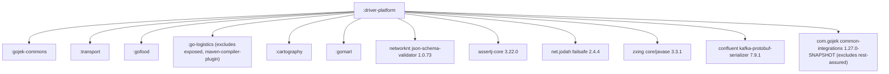
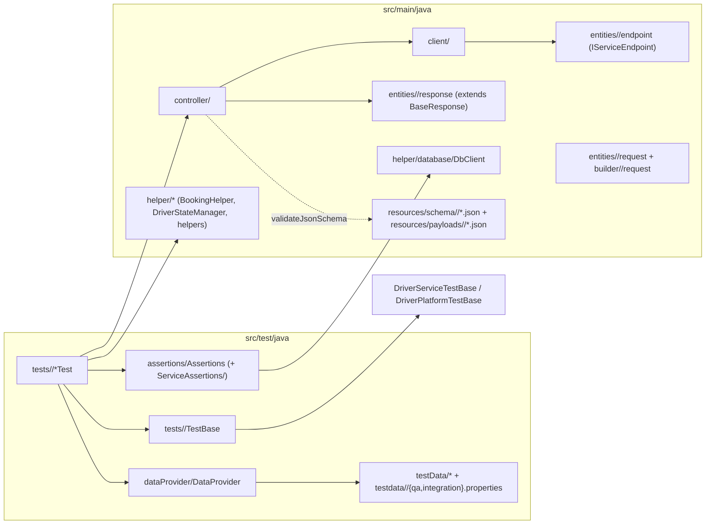
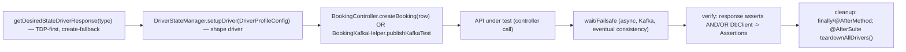

# driver-platform — Reference

Heavy detail for the `driver-platform` module profile. All snippets are trimmed
from real files under `driver-platform/src` in gojek-backend-tests and are
illustrative of the pattern to follow (not literal copy targets).

## 1. Dependency graphs

### 1a. Gradle inter-module + external libraries
From `driver-platform/build.gradle` + root `settings.gradle`.



TestNG runner config lives in `build.gradle` (`runTests` / `runTestsInParallel`
with ReportPortal/Slack/TestRail/Extent listeners); JDK17 `--add-opens` flags are
mandatory. Tests are selected by `-Dtag=<group>`.

### 1b. Intra-module layers + base-class hierarchy



Base hierarchy: `<Svc>TestBase` -> `DriverServiceTestBase` / `DriverServiceBaseTests`
-> `DriverPlatformTestBase`. The platform root owns `@BeforeClass` wiring
(`ScenarioContext`, driver controllers, `DriverTestDataHelper`) and `@AfterSuite`
(`DBUtilities.closeDBConnections()`). Service bases add their controllers/helpers/
DB-clients/assertions as `protected` fields and an `ITest` `@BeforeMethod` that
builds the dynamic test name.

### 1c. API + data dependency graph (setup -> main -> verify -> cleanup)



## 2. Vertical-slice exemplar (Dracarys: get-all-driver-cancellation-reasons)

The minimal end-to-end slice to copy when adding a brand-new GET endpoint.

### Endpoint — `src/main/java/entities/dracarys/endpoint/GetAllDriverCancellationReasonsEndpoint.java`
```java
package entities.dracarys.endpoint;

import properties.DriverPlatformPropertiesInternal;
import restidioms.security.core.template.HttpMethod;
import restidioms.security.core.template.IServiceEndpoint;
import restidioms.security.core.template.UserType;

public class GetAllDriverCancellationReasonsEndpoint implements IServiceEndpoint {
    @Override public String url() { return DriverPlatformPropertiesInternal.getAllDriverCancellationReasonsUrl; }
    @Override public HttpMethod httpMethod() { return HttpMethod.GET; }
    @Override public UserType userType() { return null; }
}
```

### Client — `src/main/java/client/Dracarys/DracarysClient.java`
```java
package client.Dracarys;

import entities.dracarys.endpoint.GetAllDriverCancellationReasonsEndpoint;
import restidioms.security.core.entity.IAPIResponse;
import restidioms.security.utility.RequestHandler;

public class DracarysClient {
    public IAPIResponse getAllDriverCancellationReasons() {
        GetAllDriverCancellationReasonsEndpoint endpoint = new GetAllDriverCancellationReasonsEndpoint();
        return new RequestHandler().processAPIRequest(endpoint);
    }
}
```

### Controller — `src/main/java/controller/Dracarys/DracarysController.java`
```java
package controller.Dracarys;

import client.Dracarys.DracarysClient;
import entities.dracarys.response.GetAllDriverCancellationReasonsResponse;
import lombok.SneakyThrows;
import restidioms.security.core.entity.IAPIResponse;

public class DracarysController {
    DracarysClient dracarysClient = new DracarysClient();

    @SneakyThrows
    public GetAllDriverCancellationReasonsResponse getAllDriverCancellationReasons() {
        IAPIResponse response = dracarysClient.getAllDriverCancellationReasons();
        GetAllDriverCancellationReasonsResponse out = response.deserialize(GetAllDriverCancellationReasonsResponse.class);
        out.setHttpStatusCode(response.getStatusCode().getCode());
        return out;
    }
}
```

### Response — `src/main/java/entities/dracarys/response/GetAllDriverCancellationReasonsResponse.java`
```java
package entities.dracarys.response;

import com.fasterxml.jackson.annotation.JsonIgnoreProperties;
import entities.BaseResponse;
import lombok.Getter;
import lombok.Setter;
import java.util.List;

@Getter @Setter @JsonIgnoreProperties(ignoreUnknown = true)
public class GetAllDriverCancellationReasonsResponse extends BaseResponse {
    private List<DriverCancellationReason> reasons;

    @Getter @Setter @JsonIgnoreProperties(ignoreUnknown = true)
    public static class DriverCancellationReason {
        private String stanMarshId;
        private String code;
        private List<String> serviceTypes;
        private Boolean isPunishable;
        private String countryCode;
    }
}
```

### BaseResponse — `gojek-commons/src/main/java/entities/BaseResponse.java`
```java
package entities;

import lombok.Getter;
import lombok.Setter;
import static org.testng.Assert.assertEquals;

@Getter @Setter
public class BaseResponse {
    public int httpStatusCode;
    public void assertHttpStatusToBe(int httpStatusCode) {
        assertEquals(getHttpStatusCode(), httpStatusCode, "HTTP Status code is not matching");
    }
}
```

### Test — `src/test/java/tests/Dracarys/GetAllDriverCancellationReasonsTest.java`
```java
package tests.Dracarys;

import com.gojek.TestInfo;
import config.TestRailConfig;
import constants.api.HttpStatuses;
import controller.Dracarys.DracarysController;
import entities.dracarys.response.GetAllDriverCancellationReasonsResponse;
import org.slf4j.Logger;
import org.slf4j.LoggerFactory;
import org.testng.Assert;
import org.testng.annotations.Test;
import tests.DriverPlatformTestBase;

public class GetAllDriverCancellationReasonsTest extends DriverPlatformTestBase {
    private static final Logger log = LoggerFactory.getLogger(GetAllDriverCancellationReasonsTest.class);
    private final DracarysController dracarysController = new DracarysController();

    @Test(groups = {DracarysTestCategories.DRACARYS_SANITY, DracarysTestCategories.DRACARYS_REGRESSION},
          description = "Verify Get All Driver Cancellation Reasons API returns 200 status code")
    @TestInfo(projectId = TestRailConfig.DRIVER_PLATFORM_PROJECT_ID,
              suiteId = TestRailConfig.DRIVER_PLATFORM_TEST_SUITE_ID,
              testCaseIds = {""}, owner = TestRailConfig.OWNER_ABDUL_AZIZ)
    public void verifyGetAllDriverCancellationReasonsReturnsSuccess() {
        GetAllDriverCancellationReasonsResponse response = dracarysController.getAllDriverCancellationReasons();
        Assert.assertEquals(response.getHttpStatusCode(), HttpStatuses.OK.getCode(), "Status code should be 200");
        Assert.assertNotNull(response.getReasons(), "Reasons list should not be null");
        Assert.assertFalse(response.getReasons().isEmpty(), "Reasons list should not be empty");
        log.info("Successfully retrieved {} cancellation reasons", response.getReasons().size());
    }
}
```

## 3. Test patterns (12) — anchor + when to use + snippet

### Pattern 1 — Test base hierarchy + dynamic naming
When: any new test/service. Extend the closest existing base; add shared wiring
to `<Svc>TestBase`, not per-test.
Anchors: `tests/DriverPlatformTestBase.java`, `tests/swadaya/SwadayaTestBase.java`,
`tests/bff/BffServiceTestBase.java`.
```java
public class SwadayaTestBase extends DriverPlatformTestBase implements ITest {
    protected SwadayaController swadayaController = new SwadayaController();
    protected SwadayaDbClient swadayaDBClient = new SwadayaDbClient();
    protected SwadayaAssertions swadayaAssertions = new SwadayaAssertions();
    protected RetryPolicy<Object> retryPolicyForFailure =
        new RetryUtil().getRetryPolicyForAssertionError(10, 3);

    @BeforeMethod(alwaysRun = true)
    public void beforeMethod(Method method, Object[] testData, ITestContext ctx) {
        testName.set(testData.length > 0 ? method.getName() + "_" + testData[0] : method.getName());
        ctx.setAttribute(testName.get(), "ID");
    }
    @AfterSuite(alwaysRun = true)
    public void teardownSharedTestData() { DriverStateManager.teardownAllDrivers(); }
}
```

### Pattern 2 — Component test (single API)
When: one endpoint, fixed/pooled subject. See the Dracarys test above; the
generic shape:
```java
String driverId = DriverData.DRIVER_WITH_NO_VOUCERS.getDriverId();      // or getDesiredStateDriverResponse(type)
GetVouchersResponse res = swadayaController.getVouchers(driverId);
SwadayaAssertions.verifyEmptyVoucherResponse(res);                       // reuse <Svc>Assertions
```

### Pattern 3 — API chaining (multi-API workflow)
When: the API under test needs a created booking/order/record first.
Anchors: `tests/Dracarys/GetDriverPunishableCancellationsTest.java`,
`tests/passbook/GetIncomeSummaryTest.java`.
```java
DesiredStateDriverResponse driver = getDesiredStateDriverResponse(type);
GenericBookingResponse booking = bookingController.createBooking(bookingDataProviderRow);
String orderNumber = booking.getBookingFlowCache().getV1MakeBookingResponse().getOrder_number();
TestHelper.wait(DELAY_FOR_BOOKING_INFO);                                 // async/Kafka
Failsafe.with(retryPolicyForFailure).run(() -> {
    IncomeSummaryResponse res = passbookServiceController.getIncomeSummary(driverId, locale);
    passbookServiceAssertions.verifyIncomeServiceResponse(res, countryCode, booking, row);
});
```
Write-then-read verification (POST then GET the same key) and Kafka-injected
prerequisites (`new BookingKafkaHelper().publishKafkaTest(scenarioContext, row)`)
follow the same wait/Failsafe discipline. Carry state object-to-object, never via
shared mutable fields.

### Pattern 4 — End-to-end test
When: a multi-service journey. Place under `tests/<svc>/e2eTests|endToEndTests|E2ETest`.
Anchors: `tests/swadaya/CpfEndToEndTests.java`,
`tests/swadayaFinance/DriverSubscriptionReconcileTests.java`,
`tests/commradService/e2eTests/EmergencyCommsTests.java` (parallel via
`ExecutorService`/`Future`). Chain ids across services; mix DB mutation + API +
DB verify; reuse `<Svc>Assertions` statics.

### Pattern 5 — Async + retry
When: any read after an async write. Never assert immediately.
```java
RetryPolicy<Object> retryPolicyForFailure = new RetryUtil().getRetryPolicyForAssertionError(10, 3);
AtomicReference<PostV1SubscriptionSchemeResponse> ref = new AtomicReference<>();
Failsafe.with(retryPolicyForFailure).run(() -> {
    ref.set(swadayaFinancialController.postV1SubscriptionScheme(req));
    swadayaFinanceAssertions.verifyPostV1SubscriptionSchemeSuccessResponse(ref.get());
});
```

### Pattern 6 — Request building (four flavours)
When: constructing a request body/header. Reuse the service's existing builder.
- Static builder-factory wrapping a Lombok `@Builder` entity (`builder/bff/request/...Builder.build(...)`).
- JSON-template load + mutate:
```java
PostV1SubscriptionSchemeRequestBody body = new ObjectMapper().readValue(
    new File("src/main/resources/payloads/swadayaFinance/postV1SubscriptionSchemeRequestBody.json"),
    PostV1SubscriptionSchemeRequestBody.class);
body.setServiceArea(DriverSubscriptionConstants.DEFAULT_SERVICE_AREA_ID);   // mutate, then send
```
- HashMap<String,Object> -> helper factory (selfOnboarding, hogwarts driver council).
- Negative case: build a valid request, mutate one field (`req.setXUserLocale("")`).

### Pattern 7 — Assertions (taxonomy)
When: validating a response. Reuse `assertions/<Svc>Assertions`.
```java
SoftAssert softAssert = new SoftAssert();
softAssert.assertEquals(res.getHttpStatusCode(), HttpStatuses.OK.getCode(), "status code does not match");
softAssert.assertTrue(res.getSuccess(), "Success is false");
softAssert.assertAll();
// full-object compare against a JSON fixture, ignoring volatile fields:
ObjectComparator.INSTANCE.compareActualToExpectedObject(actual, expected,
    Arrays.asList("data.merchants.today_open_status.status"));
```
Also: hard `Assert.*(actual, expected, message)` for status/success; entity
self-asserts (`response.assertDriverProfileResponse()`); translation-aware
(`TranslationHelper.getTranslation`) and currency (`CurrencyHelper`) checks.

### Pattern 8 — JSON schema validation (controller-side)
When: the API has a contract schema. Validate in the controller, on HTTP 200.
```java
public GetTopicDetailsResponse getTopicDetails(String driverId, Country country, String topicId) {
    IAPIResponse response = hogwartsClient.getTopicDetails(driverId, country, topicId);
    if (response.getStatusCode().getCode() == HttpStatus.SC_OK) {
        response.validateJsonSchema("schema/hogwarts/topicDetailsSchema.json");   // resources/schema/<svc>/
    }
    return response.deserialize(GetTopicDetailsResponse.class);
}
```

### Pattern 9 — DB setup + verification
When: state isn't observable via API, or must be seeded/mutated.
Anchors: `helper/database/SwadayaDbClient.java`, `SwadayaFinanceDbClient.java`.
```java
public class SwadayaDbClient {
    private static final JdbcTemplate jdbcTemplate =
        DBUtilities.getDB(DBName.SWADAYA_SERVICE.getName()).getJdbcTemplate();
    @SneakyThrows public void updateBirthDate(String driverId, int age) { jdbcTemplate.update("UPDATE ..."); }
    public List<Map<String,Object>> getTransactionsByDriverId(String id) { return jdbcTemplate.queryForList("SELECT ..."); }
}
// verify: query -> *QueryResultBuilder.buildFromListOfMap(...) -> <Svc>Assertions.*InDb(...), often inside Failsafe.
```

### Pattern 10 — Data providers (flavours)
When: parameterising a test. Match the existing provider style for the service.
```java
@DataProvider(name = "verifyDriverProfileV2", parallel = true)
public Object[][] verifyDriverProfileV2() {
    return new Object[][]{ {DriverType.ID_BIKE}, {DriverType.SG_CAR} };          // static matrix
}
// lazy expensive setup (memoised):
public static final LazyInitializer<String> DRIVER_WITHOUT_SUBSCRIPTION =
    new LazyInitializer<>(() -> DriverSubscriptionHelper.getDriverIdWithoutAnyRegisteredSubscription(DriverType.ID_BIKE));
// properties-backed pooled ids: DriverPlatformTestDataProperties.get<Svc>TestData().getProperty("...");
// builder rows: BookingDataProviderRow.builder().createDriver(ConfigLoader.getInstance()
//     .getDriverTestDataConfigByDriverType(DriverType.ID_BIKE))...build();
```

### Pattern 11 — Driver/customer/booking creation + driver-state shaping
When: a test needs a driver/customer/booking. Use shared helpers only.
Anchors: `helper/BookingHelper.java`, `helper/testData/driver/DriverStateManager.java`.
```java
DesiredStateDriverResponse driver = BookingHelper.getDesiredStateDriverResponse(DriverType.ID_BIKE); // TDP-first, create-fallback
String driverId = DriverStateManager.setupDriver(driver,                                             // shape + register for teardown
    DriverProfileConfig.builder().cpfProgramType(CpfProgramType.CPF).build()).getDriverId();
GenericBookingResponse booking = new BookingController().createBooking(row);                          // booking
// leads (selfOnboarding) differ: SelfOnboardingController.getBearerTokenForNewLead(country), no pool.
```

### Pattern 12 — Cleanup discipline
When: a test creates a persistent resource (scheme/form/driver/record).
```java
String schemeId = "";
try {
    schemeId = createScheme(...);
    // ... assertions ...
} finally {
    cleanUpData(schemeId);                 // deactivate/delete what you created
}
// pooled/shaped drivers are released centrally at @AfterSuite -> DriverStateManager.teardownAllDrivers().
```

## 4. Naming / placement tables

| Artifact | Directory (under driver-platform) | Naming |
|----------|-----------------------------------|--------|
| Endpoint | `src/main/java/entities/<svc>/endpoint` | `<Action><Resource>Endpoint` implements `IServiceEndpoint` |
| Client | `src/main/java/client/<Svc>` | `<Svc>Client` |
| Controller | `src/main/java/controller/<Svc>` | `<Svc>Controller` (`@SneakyThrows`) |
| Request entity | `src/main/java/entities/<svc>/request` | `<Action><Resource>Request[Body|Header]` (Lombok `@Builder`) |
| Request builder | `src/main/java/builder/<svc>/request` | `<Action><Resource>RequestBuilder` (static `build(...)`) |
| Response | `src/main/java/entities/<svc>/response` | `<Action><Resource>Response extends BaseResponse` |
| Helper | `src/main/java/helper[/<svc>]` | `<Svc>Helper` / domain helper |
| DB client | `src/main/java/helper/database` | `<Svc>DbClient` |
| Schema/payload | `src/main/resources/schema/<svc>`, `.../payloads/<svc>` | `<name>Schema.json`, `<name>RequestBody.json` |
| Test | `src/test/java/tests/<svc>[/componentTests|e2eTests]` | `<Action><Resource>Test` extends `<Svc>TestBase` |
| Assertions | `src/test/java/assertions[/<svc>ServiceAssertions]` | `<Svc>Assertions` / `<Action><Resource>Assertions` |
| Data provider | `src/test/java/dataProvider` | `<Svc>DataProvider` |
| Test data props | `src/test/resources/testdata/<svc>` | `qa.properties`, `integration.properties` |
| Test categories | `src/test/java/utils` | `<Svc>TestCategories` (group constants) |

| Concern | Use |
|---------|-----|
| HTTP status enum | `constants.api.HttpStatuses.OK.getCode()` or `org.apache.http.HttpStatus.SC_OK` |
| TestRail metadata | `@TestInfo(projectId/suiteId/testCaseIds/owner = TestRailConfig.*)` |
| Retry policy | `new RetryUtil().getRetryPolicyForAssertionError(delaySec, count)` + `Failsafe.with(...)` |
| Fixed wait | `TestHelper.wait(ms)` (named constants like `DELAY_FOR_BOOKING_INFO`) |
| Logger | `private static final Logger log = LoggerFactory.getLogger(<Class>.class);` |
| Env/props | `DriverPlatformTestDataProperties.get<Svc>TestData()`, env from `INFRA`/`env` |
