# Event sequences — Consumer, Driver, and Booking creation

Every function TDP exposes for the Consumer and Driver domains, grouped by what it operates on and
shown as a simple call sequence, plus the composite sequence that ties both together into a
booking. Use this to match a signal found in a request statement to the group (and exact
operation) that produces or reads that state. Sources: `CustomerController.java`,
`DriverController.java`, `TestDataPoolingController.java`, `BookingController.java`.

---

## Consumer sequences

### 1. Identity & lookup

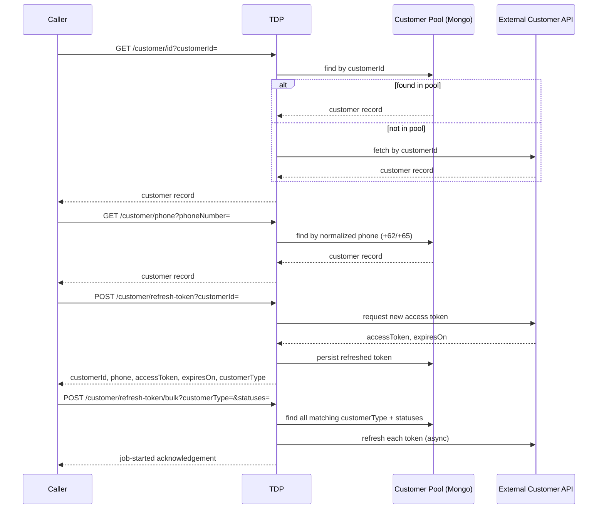

Signals: `customerId`, `phone`, `accessToken` freshness/expiry, `customerType`, pool status
(`AVAILABLE`, `ENGAGED`, `INVALID`, …).

### 2. Wallet — GoPay balance, coins, wallet ID

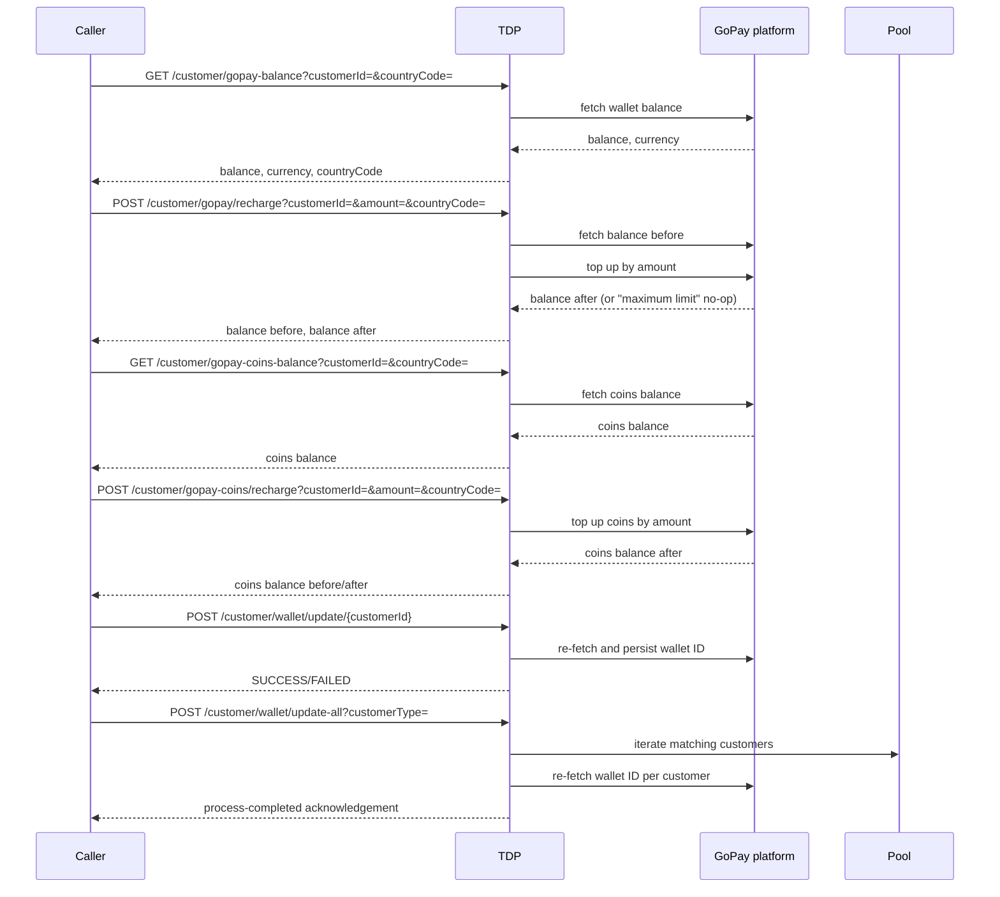

Signals: `wallet_balance_idr`/GoPay balance amount, GoPay coins balance, `countryCode`
(`ID`→IDR, `SG`→SGD), wallet ID staleness.

### 3. Loyalty

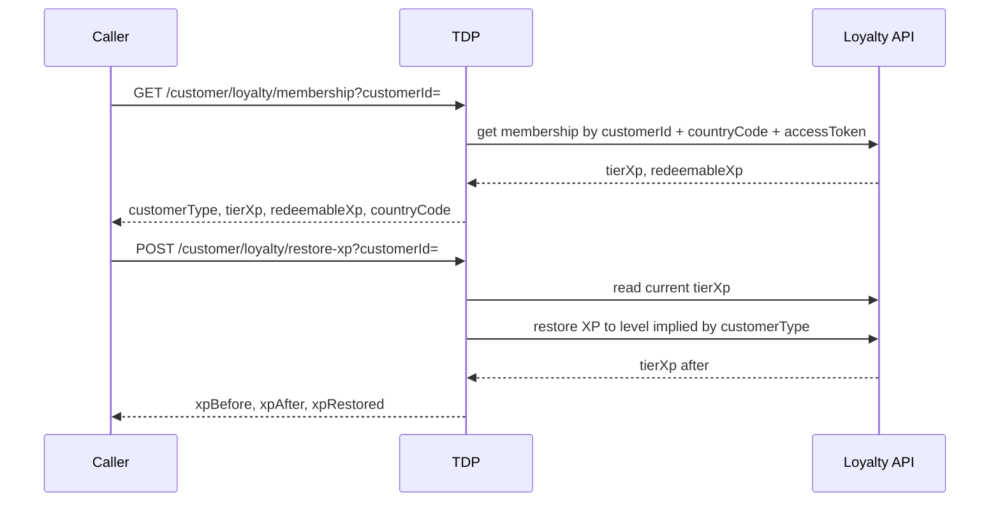

Signals: `tierXp`, `redeemableXp`, `customerType` loyalty tier (e.g. `CUSTOMER_WITH_30k_STATUS_STAR`).
`restore-xp` only accepts a `customerType` containing `STATUS_STAR`.

### 4. Segmentation

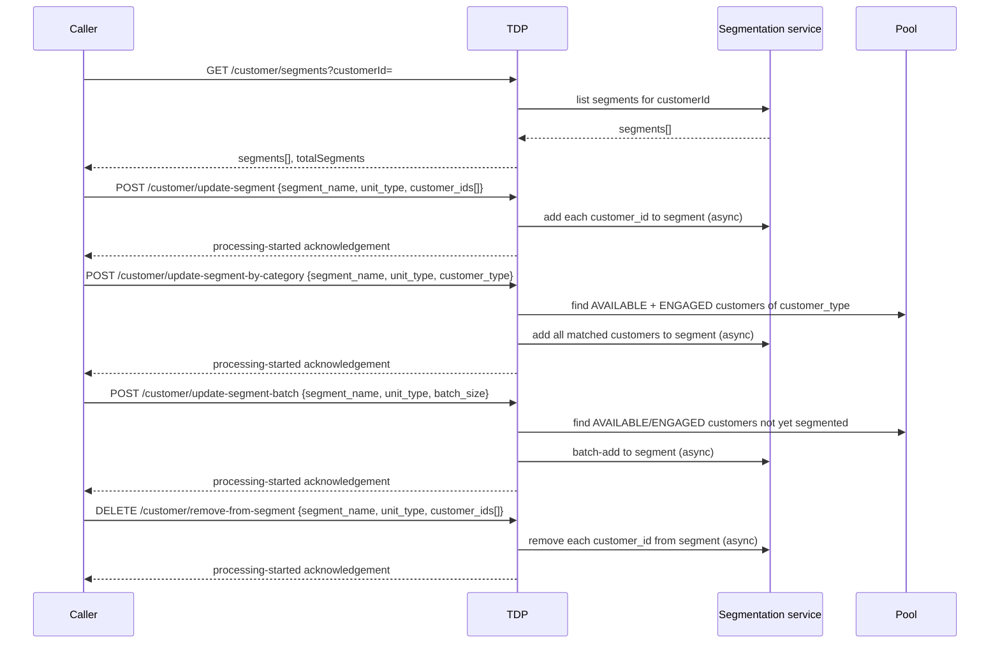

Signals: `segmentName`, `unitType`, membership in a named segment, `gamificationSegmented` flag.

### 5. Blacklist

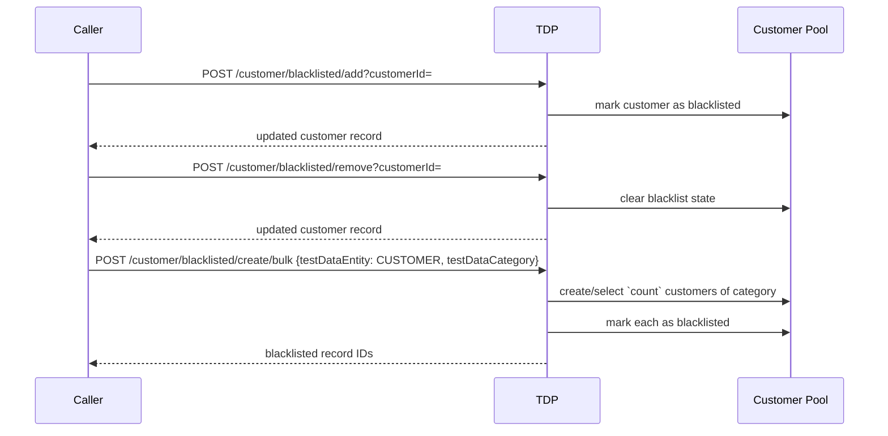

Signals: `isBlackListed`.

### 6. Saved addresses

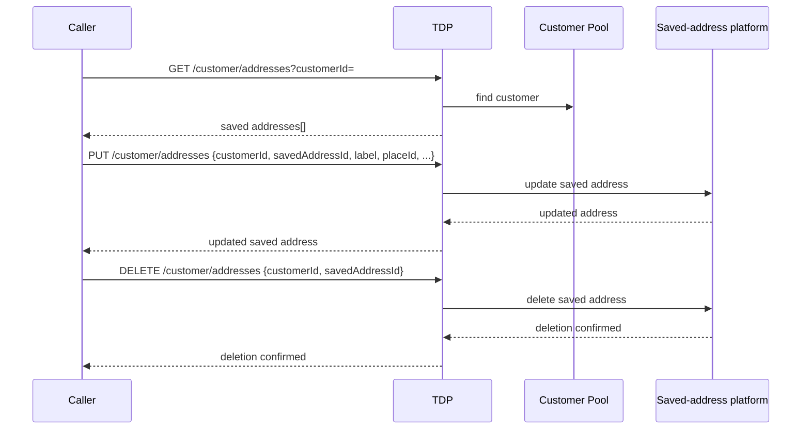

Signals: saved-address presence, `label`, `placeId` — POI vs. AOI is a category distinction
(`CUSTOMER_WITH_SAVED_ADDRESS_POI` / `_AOI`), while add/edit/delete of an individual address is a
state mutation on top of that category.

### 7. PIN

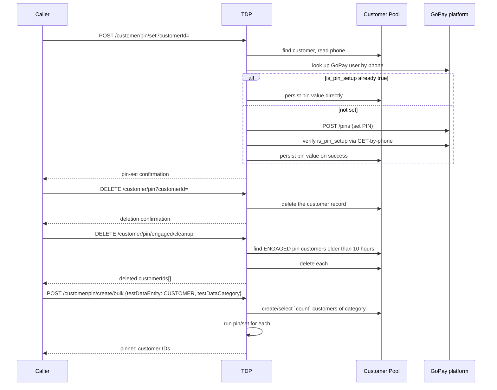

Signals: `isPinSet` / PIN presence — the `pin` field itself is the sole source of truth, there is
no separate boolean flag stored alongside it.

### 8. Pool fetch and its variants

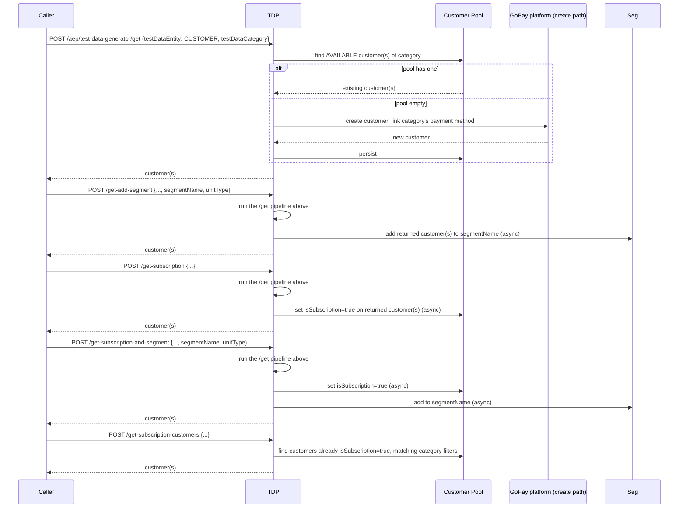

Signals: `testDataCategoryName`, `count`, `countryCode`, booking-history filters
(`hasTransportCompletedBooking`, `hasFoodCanceledBooking`, …), `used`, `isBlackListed`,
`isPinSet` — all carried on `GetTestDataRequest.TestDataCategory`. `isSubscription` and
`segmentName` membership are outcomes of the `-subscription`/`-segment` variants, not inputs.

---

## Driver sequences

### 1. Identity & lookup

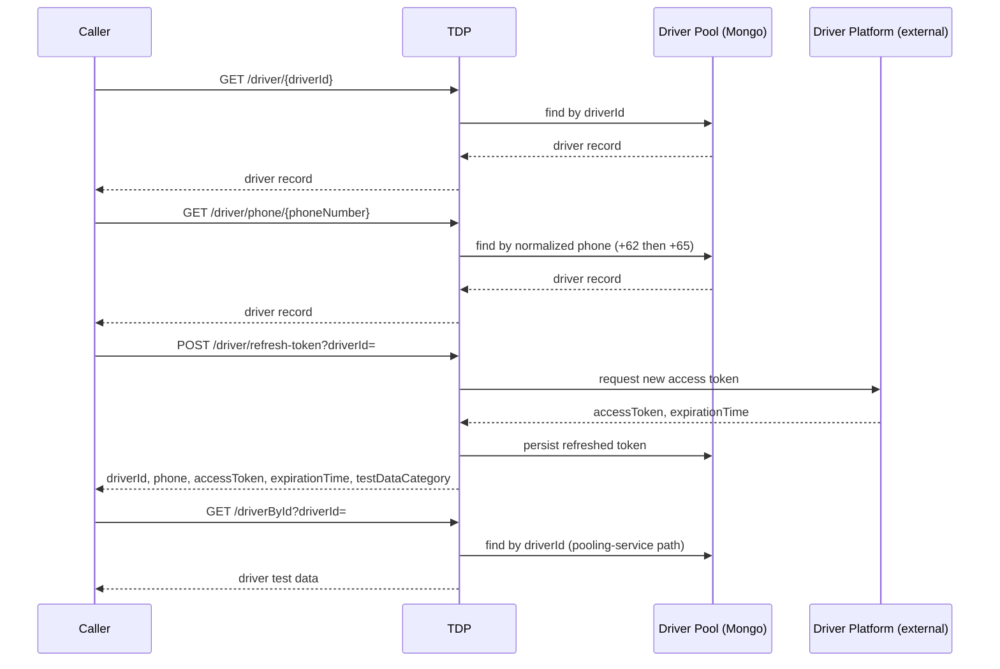

Signals: `driverId`, `phone`, `accessToken` freshness/expiry, `testDataCategory`.

### 2. Creation

```mermaid
sequenceDiagram
    participant Caller
    participant TDP
    participant DP as Driver Platform (external)
    participant Pool as Driver Pool (Mongo)

    Caller->>TDP: POST /driver/create?number=&type=&serviceArea=
    TDP->>DP: create `number` drivers of `type`, assign serviceArea (async)
    DP-->>TDP: new driverIds
    TDP->>Pool: persist new drivers
    TDP-->>Caller: "Driver creation job triggered!" (immediate; job runs in background)
```

Signals: `type` (the `DRIVER__<COUNTRY>__<TYPE>` category), `serviceArea`, `number` (count).
Fire-and-forget — there is no created-driver ID in the response, so a caller needing the resulting
driver right away should fetch from the pool instead of chaining off this call.

### 3. Wallet balance

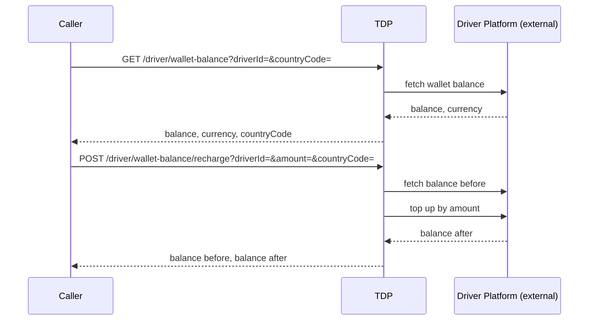

Signals: driver wallet balance amount, `countryCode` (`ID`→IDR, `SG`→SGD).

### 4. Tags

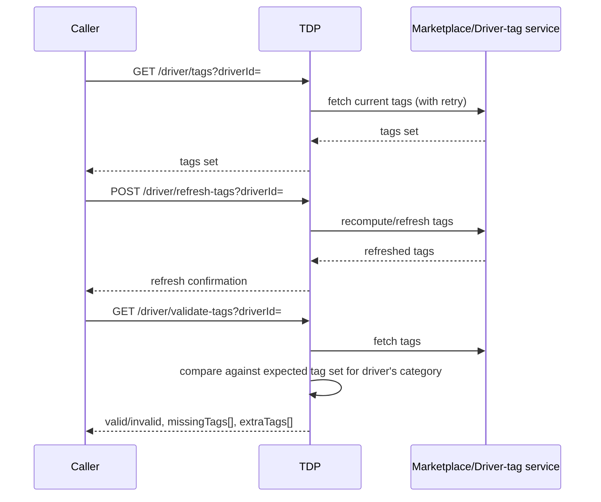

Signals: `tags` set, "correctly tagged" / "wrong tags" as a failure mode rather than a category.

### 5. Sanitisation & sanctions

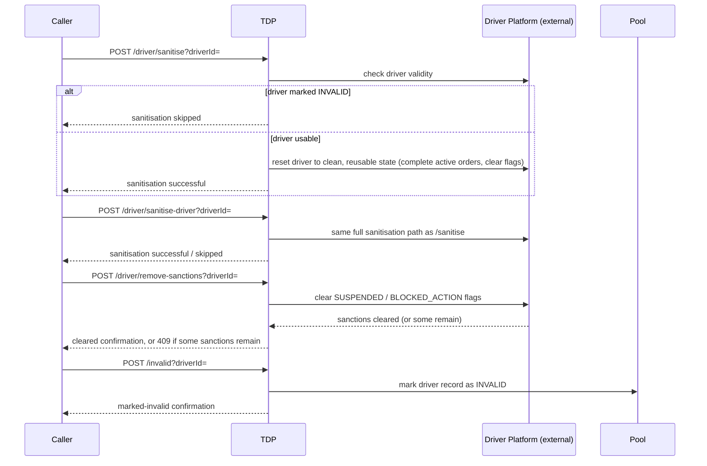

Signals: `SUSPENDED`, `BLOCKED_ACTION`, driver validity state (`INVALID` vs. usable), "dirty" pooled
driver needing reset before reuse. Note the asymmetry: TDP can clear sanctions
(`remove-sanctions`) and mark a driver invalid (`/invalid`), but there is no endpoint to *impose* a
suspension.

### 6. Pool fetch

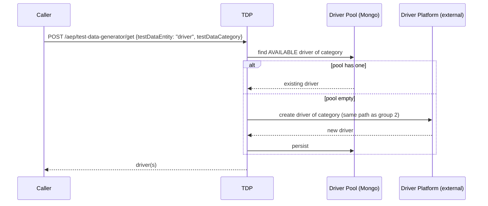

Signals: `testDataCategoryName` (`DRIVER__<COUNTRY>__<TYPE>`), `count`, `countryCode`.

### 7. Active-booking cleanliness

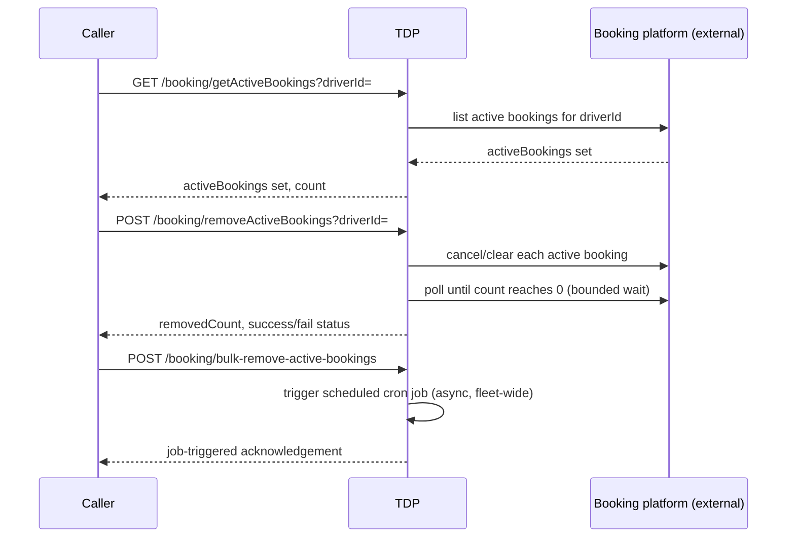

Signals: "driver currently has an active booking" vs. "a driver free/ready for allocation",
`ACTIVE_BOOKING` state.

---

## Booking creation — customer and driver, both wallets topped up first

A booking always sits on top of a customer *and* a driver. When the booking's payment mode needs a
wallet (`GOPAY_WALLET` on the customer side; the driver's own wallet for driver-side balance
checks), both wallets must be topped up **before** `createBooking` is called — TDP does not top up
either wallet as a side effect of booking creation.

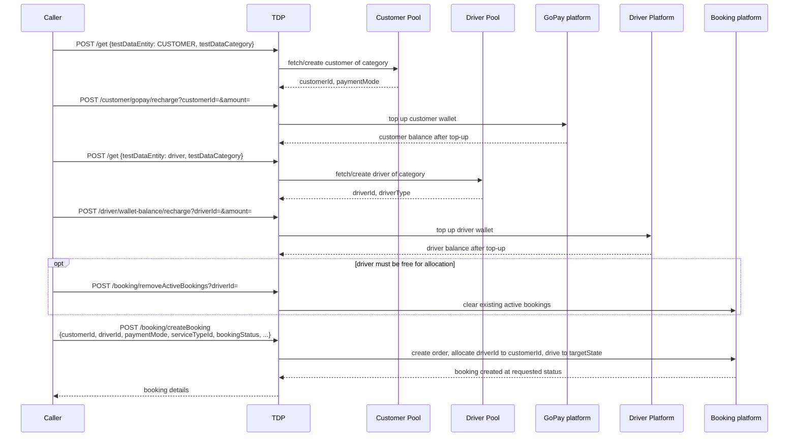

Ordering rules:
- **Customer and driver wallet top-ups happen before `createBooking`**, not after — both are
  independent prerequisites, not part of the booking call itself.
- `paymentMode` on the booking request should match the customer's category's `paymentMode`
  (`CUSTOMER_WITH_GO_PAY` → `GOPAY_WALLET`, `Vanilla` → `CASH`).
- `driverType` on the booking request should be the resolved driver category's `DriverType` (e.g.
  `ID_BIKE` for `DRIVER__ID__BIKE`), not the raw category string.
- `bookingStatus`/`targetState` values come from `BookingConfig` (`scheduled`, `confirmed`,
  `driver_arrived`, `started`, `completed`, `cancelled`, `driver_cancelled`, …).
- Skip a wallet top-up on either side when the statement's signal is about a *shortfall* (e.g.
  "insufficient balance") rather than a positive amount — recharging would erase the exact state
  being tested.

## Using this catalog for signal matching

| Wording mentions | Refer to |
|---|---|
| "gopay", "wallet", "balance", "coins", "recharge", "top up" (customer) | Consumer § 2 |
| "loyalty", "tier", "XP", "status star" | Consumer § 3 |
| "segment", "gamification" | Consumer § 4 |
| "blacklisted", "blocked" (customer) | Consumer § 5 |
| "saved address", "POI", "AOI" | Consumer § 6 |
| "PIN", "pin set" | Consumer § 7 |
| plain customer category only ("a vanilla customer", "a gopay customer") | Consumer § 8 |
| "bulk create", "seed N drivers", "in service area X" | Driver § 2 |
| "wallet", "balance", "recharge", "top up" (driver) | Driver § 3 |
| "tags", "correctly tagged", "wrong tags" | Driver § 4 |
| "reset", "clean", "sanitised", "sanctioned", "suspended", "invalid" (driver) | Driver § 5 |
| plain vehicle/service-type category only ("a bike driver") | Driver § 6 |
| "active booking", "free for allocation", "ready to be assigned" | Driver § 7 |
| "…then book a ride/order", "…used for a food order", any statement naming both a customer and a driver together | Booking creation, above |
