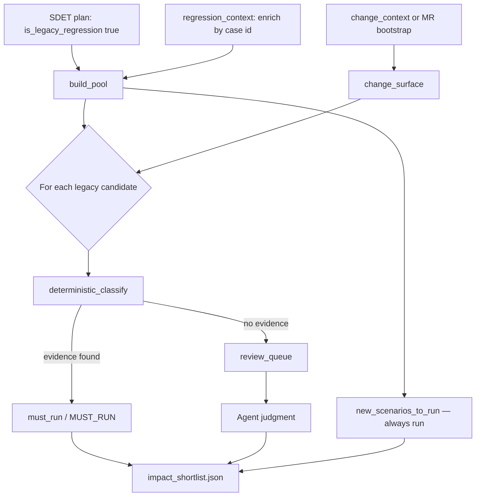

# How `shortlist_join.py` Works

**Audience:** QA, SDET, engineering leads  
**Component:** `plugins/aep-mobile/scripts/shortlist_join.py`  
**Skill:** `mobile-postbuild` → `impact-shortlister` subagent (post-build legacy regression selection)

---

## One-line summary

Given **(1) which legacy tests QA already flagged for this feature** and **(2) what code actually merged**, `shortlist_join.py` finds legacy tests with **hard evidence** they are impacted — and puts ambiguous ones in a queue for agent/human judgment.

It does **not** generate tests, rank with ML, or call external scoring services.

---

## Where it sits in the pipeline

```
PRE-BUILD                              POST-BUILD
─────────                              ──────────

sdet-plan-generator  ──► SDET plan     code-change-extractor ──► change_context.json
  (legacy rows)            │                    ▲
                           │              dev_manifest.json (dev input)
regression-extractor ──► regression_context     │
  (enrichment only)        │                    │
                           └──────────┬───────────┘
                                      ▼
                            shortlist_join.py  (this script)
                                      │
                                      ▼
                            impact_shortlist.draft.json
                                      │
                            Agent judgment on review_queue
                                      │
                                      ▼
                            impact_shortlist.json  (final sidecar)
                                      │
                            do not patch their SDET plan
```

**Division of labour**

| Who | Responsibility |
|-----|----------------|
| `shortlist_join.py` | Deterministic matching → `must_run` + `review_queue` |
| Impact-shortlister agent | Judge `review_queue` → final shortlist + audit trail |
| Downstream runner | Execute shortlisted case IDs + new scenarios |

---

## Inputs and outputs

### Inputs

| File | Required | Role |
|------|----------|------|
| `<feature>_sdet_plan.json` **or** `*_automation_plan_generator.json` | **One of them** | Legacy pool: rows with `is_legacy_regression: true` + `existing_case_ref`. APG uses `automation_scenarios[]`. |
| `regression_context.json` | Strongly recommended | Enriches candidates (title, steps, automation metadata) — **does not expand pool** |
| `change_context.json` | Preferred (production) | What merged: files, screens, modules, locators, flags, APIs, CR risks |
| `dev_manifest.json` | Fallback only | Used if `change_context.json` is not ready yet |
| GitLab MR changed-files | Bootstrap / testing | Stand-in change surface when code-change-extractor has not run (see PAM example) |

**Production path:** `dev_manifest.json` → **code-change-extractor** → `change_context.json` → **impact-shortlister**.  
Impact-shortlister normally reads **`change_context.json`**, not `dev_manifest.json` directly.

### Outputs

| Artifact | Contents |
|----------|----------|
| `impact_shortlist.draft.json` | `must_run`, `review_queue`, `new_scenarios_to_run`, `change_surface` |
| `impact_shortlist.json` | Final shortlist after agent completes review (includes `deselected_tests`). Join via `inputs`. |

---

## Three CLI commands

```bash
# 1. Deterministic draft (agent finishes the rest)
python3 scripts/shortlist_join.py draft \
  --plan <feature>_sdet_plan.json \
  # or --plan <feature>_automation_plan_generator.json \
  --regression regression_context.json \
  --change change_context.json \
  --out impact_shortlist.draft.json

# 2. Self-check
python3 scripts/shortlist_join.py --demo

# patch-plan exists but must not be run on another team's SDET plan
```

---

## Step-by-step: what `draft` does

### Step 1 — Build the candidate pool (`build_pool`)

**Question:** Which existing tests are in scope for impact analysis?

**Answer:** Only SDET plan scenarios where:

- `is_legacy_regression: true`
- `existing_case_ref` is set (e.g. `C5542964`)

Partial-overlap refs (`is_legacy_regression: false` but `existing_case_ref` present) are **out of scope** — those are new-scenario traceability, not legacy re-run candidates.

`regression_context.json` is indexed by case id and used to **enrich** title/steps when available. It never adds cases the plan did not mark as legacy.

Each candidate is keyed by numeric case number (`5542964` from `C5542964`).

---

### Step 2 — Build the change surface (`change_surface`)

**Question:** What did the merged code actually touch?

The script normalizes upstream JSON into a single structure:

| Field | Example |
|-------|---------|
| `changed_files` | `LoyaltyCatalogueFragment.kt`, `ProfileContainerFragment.kt` |
| `changed_modules` | `loyalty`, `driver-profile` |
| `changed_screens` | `LOYALTY_CATALOGUE`, `PROFILE_CONTAINER` |
| `changed_element_ids` | Logical IDs with `change_type` (added/modified/removed) |
| `flags` | `giab_pam_revamp_enabled` |
| `api_endpoints` | `/v1/loyalty/tiers`, `/v2/loyalty/rewards` |
| `cr_risks` | Reviewer edge cases from change extraction |

**Source priority**

1. `change_context.json` (preferred)
2. `dev_manifest.json` (fallback)
3. MR bootstrap — `changed_files` at top level + inferred modules/screens

When modules or screens are missing (common in MR bootstrap), the script infers them from paths — e.g. `LoyaltyCatalogueFragment` → screen id `LOYALTY_CATALOGUE`.

---

### Step 3 — Build searchable text per candidate (`haystack`)

For each legacy candidate, concatenate:

```
title + all steps  →  one lowercase string
```

Example: *"validate loyalty and point section on profile menu … driver tap on profile icon …"*

Matching is **plain substring containment** — no embeddings, no fuzzy scoring.

---

### Step 4 — Evidence matching (`deterministic_classify`)

For each candidate, check whether the change surface overlaps the test's haystack.

| Reason code | Match rule |
|-------------|------------|
| `MODULE_TOUCHED` | Candidate `source_module` ∈ `changed_modules` |
| `SCREEN_TOUCHED` | Changed screen id appears in title/steps |
| `LOCATOR_CHANGED` | Modified/removed element token appears in title/steps |
| `FLAG_TOUCHED` | Flag name appears in title/steps |
| `API_CONTRACT_CHANGED` | API endpoint path appears in title/steps |
| `CR_RISK` | CR risk area or suggested test overlaps text |
| `FILE_PATH_TOUCHED` | High-signal path tokens (loyalty, profile, catalogue, …) match title/steps — used heavily in MR bootstrap |

**Any hit → `MUST_RUN`** with `reason_codes` and structured `evidence`.

**No hit → `review_queue`** for agent judgment.

**Important:** Plan linkage (`plan_scenario_refs`) is **traceability only**. Being listed in the SDET plan does **not** auto-shortlist a legacy case without change evidence.

---

### Step 5 — Split results (`draft`)

| Bucket | Meaning |
|--------|---------|
| `must_run` | Deterministic evidence — **never demoted** downstream |
| `review_queue` | No hard match — agent reads title/steps vs change scope |
| `unresolved_ids` | Malformed id or missing title — never silently dropped |
| `new_scenarios_to_run` | All non-legacy plan scenarios — **always run** (new feature coverage) |

The draft also records `candidate_pool_size`, a copy of `change_surface`, and input provenance.

---

## What happens after the script (agent step)

The script intentionally stops at the draft. The impact-shortlister agent:

1. Reads each `review_queue` entry against the change surface and plan `scope_summary`
2. Assigns:
   - **Plausibly related** → `SHOULD_RUN` + `AGENT_JUDGED_RELEVANT` + one-sentence explanation
   - **Weakly related** → `OPTIONAL` + explanation
   - **No link** → `deselected_tests` + `NO_IMPACT_SIGNAL` + explanation
3. Writes final `impact_shortlist.json` (sidecar). Do **not** run `patch-plan` on another team's SDET plan.

---

## Flow diagram



---

## Worked example: PAM 8 Levels

See `examples/pam_feature/IMPACT_SHORTLISTER_REPORT.md` for the full validation.

| Aspect | PAM run |
|--------|---------|
| Legacy pool | 5 Loyalty Revamp cases (example plan; production plan needs `is_legacy_regression: true` rows) |
| Change surface | 120 files from GitLab MRs !13303–!13386 (`gitlab_mr_diff` bootstrap) |
| Match | All 5 → `FILE_PATH_TOUCHED` (steps mention loyalty/profile; MRs changed loyalty + profile code) |
| Result | 5 × `MUST_RUN`, 0 deselected |
| New coverage | 36 non-legacy PAM scenarios in `new_scenarios_to_run` |

---

## Design principles (why it works for any feature)

1. **Bounded pool** — Legacy-only from the approved SDET plan, not the full regression corpus (~7000 tests).
2. **Reproducible** — Same inputs always produce the same `must_run` set; auditable reason codes.
3. **Two-tier selection** — Script for hard evidence; agent once for ambiguity. No opaque ranking formula.
4. **Progressive input quality** — MR file bootstrap today; full `change_context.json` tomorrow (locators, APIs, CR risks) without rewriting the skill.
5. **Safe defaults** — Empty legacy pool → `LIMITED`, not “skip regression”. Every skip is recorded in `deselected_tests`.

---

## Simple analogy

| Stage | Analogy |
|-------|---------|
| Pre-build SDET plan | “Here are the old tests that **might** matter for this feature.” |
| Post-build change surface | “Here’s what **actually changed** in the merged code.” |
| `shortlist_join.py` | “Which old tests **clearly** touch what changed?” |
| Agent | “For the unclear ones, read the test and decide.” |

---

## Related files

| Path | Description |
|------|-------------|
| `skills/impact-shortlister/SKILL.md` | Agent skill instructions |
| `scripts/shortlist_join.py` | This script |
| `schemas/impact_shortlist.schema.json` | Output contract |
| `examples/pam_feature/impact_shortlist.json` | Sample output |
| `examples/pam_feature/IMPACT_SHORTLISTER_REPORT.md` | PAM validation report |

---

## Glossary

| Term | Meaning |
|------|---------|
| **Legacy regression** | Existing BrowserStack case the plan marks with `is_legacy_regression: true` — re-run candidate, not new automation |
| **Change surface** | Normalized view of what merged code touched |
| **MUST_RUN** | Deterministic tier — backed by evidence, never demoted |
| **SHOULD_RUN / OPTIONAL** | Agent-judged tiers for review_queue items |
| **MR bootstrap** | Temporary change surface built from GitLab MR changed-file lists |
