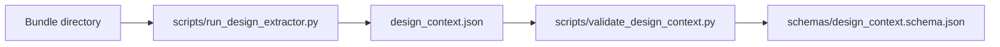

# Design extractor workflow

Read in order:

1. **[BUNDLE_INPUT.md](./BUNDLE_INPUT.md)** — bundle envelope, mapping, and trial scope labels.
2. **[agents/design-extractor.md](../../agents/design-extractor.md)** — Phase A preflight, extraction procedure, validation.

## Two pipelines

| Pipeline | Who | Input | Runner |
|----------|-----|-------|--------|
| **Phase A (agents)** | `design-extractor` subagent / orchestrator | **figma-design-bundle directory only** (`manifest.json` with `generator.name === "figma-design-bundle"`) | `scripts/run_design_extractor.py` → `scripts/design_extractor/` |
| **Maintainer (not Phase A)** | Humans updating golden/spatial tests | Legacy single-file Export Design Raw JSON v2 under `agents/design-extractor/golden/` | `agents/design-extractor/run_design_extractor.py` |

Phase A agents **must not** call the maintainer script, open live Figma URLs, or substitute a legacy Raw JSON file when the bundle is missing. If `manifest.json` is absent or `generator.name` is wrong → emit `extraction_status: INCOMPLETE` with a **BLOCKING** gap: re-export as a **figma-design-bundle** on disk. The orchestrator may still spawn `design-extractor` when the user shares only a Figma URL (`design_url_hint`) — the agent writes the same kind of BLOCKING stub without fetching Figma.



```bash
# From plugins/aep-mobile (set AEP_TRIAL_BUNDLE for full trial export)
python3 scripts/run_design_extractor.py \
  --bundle "${AEP_TRIAL_BUNDLE:-path/to/bundle}" \
  --plugin-root . \
  --app gofood-consumer \
  --out examples/gofood-group-order-bundling/design_context.json

python3 scripts/validate_design_context.py \
  examples/gofood-group-order-bundling/design_context.json \
  --schema schemas/design_context.schema.json \
  --fixture gofood-group-order-bundling
```

The agent may adjust `visual_analysis_scratchpad`, merge human notes, or refine `extraction_gaps` — it should **not** re-derive trees by hand when a bundle is present.
